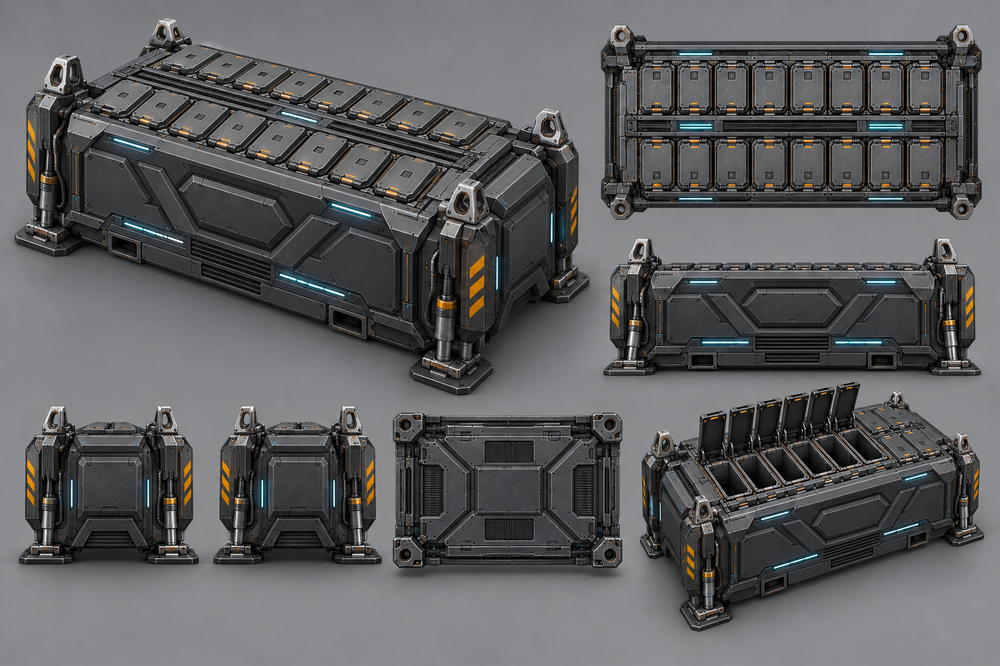

# 母艦用ミサイルコンテナ V2 造形提案

## 比較結果

従来案は20セルを読み取りやすい一方、長方形の外周フレームと垂直側壁が支配的で、カーゴコンテナが持つ台形の量塊、四隅の支持構造、油圧脚、吊り上げ荷重の流れが弱かった。そのため、同じ母艦へ装着する姉妹装備ではなく、別規格の据置きランチャーに見えていた。

V2はカーゴコンテナの共通シャーシを次の要素で継承する。

- 上面を狭く、下部荷重フレームを広くした台形断面
- 上肩と端面の面取りによる、箱ではない連続した外殻
- 四隅の吊り環、縦フレーム、油圧シリンダー、接地パッド
- 母艦へ引き上げる荷重と、地上へ置く荷重が同じ骨格を通る構造
- 黒鉛色の装甲、限定したシアン状態灯、整備箇所だけのアンバー表示

ミサイル固有部は、上面へ後付けした箱ではなく、傾斜した外殻へ埋め込んだ左右10基ずつの発射セルとする。閉鎖時は装甲面と連続し、整備・発射時だけ個別ハッチが起立する。

## 3Dモデル化時の修正事項

提案画像をそのまま正本メッシュとはしない。モデル化では次を確定する。

1. 実セル数を左10・右10の合計20へ固定する。
2. 四隅の吊り環中心をカーゴコンテナと共通化する。
3. 油圧脚の収納、伸長、圧縮の3状態を用意する。
4. 脚は母艦搭載時に外形内へ格納し、ハードポイントやハッチと干渉させない。
5. コンテナ全高はカーゴと同じ搭載包絡へ収める。
6. ミサイルセル、中央隔壁、点検パネル、脚を完全な左右対称で作る。
7. Minecraft用モデルでは、ボルトや配管を面へ焼き込み、可動部と輪郭にポリゴンを集中する。

## 承認対象

この段階の承認対象は、台形の共通シャーシ、油圧脚の存在感、20セルの配置、カーゴとの製品系列感である。承認後に同一メッシュから上下左右前後、閉鎖、ハッチ展開、脚伸長、母艦搭載、アイコンを作成する。
